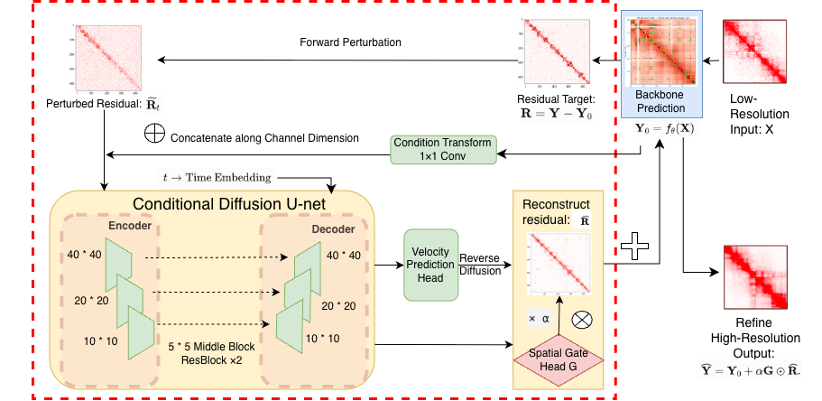

# ChromDiffusion

**ChromDiffusion: Refining Chromatin Structure Characterization Through Diffusion Models**

*Yang Zhao, Tomoya Kanno, Chong Li, and Xinghua Shi*  
**Manuscript status:** Under review

ChromDiffusion is a diffusion-based framework for refining predicted high-resolution Hi-C contact maps. It is designed to improve chromatin contact-map reconstruction by learning corrections to the outputs of existing Hi-C super-resolution models.

## Overview

Hi-C experiments measure spatial contacts between genomic loci, but generating high-resolution contact maps can be costly and data-intensive. ChromDiffusion builds on an existing super-resolution backbone and applies a diffusion-based refinement stage to its predicted contact maps.

<p align="center">
  
</p>

<p align="center">
  <em>Overview of the ChromDiffusion framework.</em>
</p>

The repository includes implementations and related resources for several Hi-C reconstruction backbones. Please cite the original paper when using a backbone:

- **HiCARN** (`HiCARN/`): Hicks and Oluwadare, *Bioinformatics* 2022. https://doi.org/10.1093/bioinformatics/btac156
- **HiCNN** (`HiCNN/`): Liu and Wang, *Bioinformatics* 2019. https://doi.org/10.1093/bioinformatics/btz251
- **DeepHiC** (`deephic/`): Hong et al., *PLOS Computational Biology* 2020. https://doi.org/10.1371/journal.pcbi.1007287
- **SRHiC** (`srhic/`): Li and Dai, *Frontiers in Genetics* 2020. https://doi.org/10.3389/fgene.2020.00353

ChromDiffusion is intended to complement these backbones rather than replace them.

## Framework

1. Prepare paired low- and high-resolution Hi-C contact-map patches (`preprocessing/`).
2. Generate an initial high-resolution prediction using a backbone model (the backbone folders).
3. Apply diffusion-based refinement to the backbone prediction (see Scripts Used in the Manuscript).
4. Evaluate reconstructed contact maps against reference data (`benchmark/`).

## Repository Structure

```text
Chromdiffusion/
├── HiCARN/         # HiCARN backbone; ChromDiffusion scripts in residual_diffusion_v6/
├── HiCNN/          # HiCNN backbone and ChromDiffusion scripts
├── deephic/        # DeepHiC backbone and ChromDiffusion scripts
├── srhic/          # SRHiC backbone and ChromDiffusion scripts
├── preprocessing/  # GEO download to 40 × 40 model input tiles
├── benchmark/      # TAD and loop benchmark, plus supplementary evaluations
├── Figures/        # Figures used in this README
└── CITATION.cff    # Citation metadata
```

## Scripts Used in the Manuscript

The ChromDiffusion model is trained with `train_v15.py`, and `test_v15.py` runs inference and computes the evaluation metrics. For HiCARN these scripts are in `HiCARN/residual_diffusion_v6/`. For the other backbones they are at the top level of `HiCNN/`, `deephic/` and `srhic/`. The training script is identical in all four folders; its `--train_hicarn` and `--val_hicarn` arguments take the predictions of whichever backbone is being refined.

The results in the manuscript are labelled as follows:

- **HiCARN, Run A/B/C**: three checkpoints from training on HiCARN outputs. The manuscript gives the selection criteria for each.
- **Struct-Diff** (HiCNN, DeepHiC, SRHiC): the model trained on that backbone's own outputs.
- **Cross-Diff** (HiCNN, DeepHiC, SRHiC): the model trained on HiCARN outputs, applied without retraining to that backbone's predictions.
- **Vanilla-Diff** (HiCNN, DeepHiC, SRHiC): diffusion refinement without structural constraints, from `train_residual_diffusion.py` and `test_residual_diffusion.py` in `HiCNN/`, `deephic/` and `srhic/`.

The other `residual_diffusion*` folders under `HiCARN/` hold earlier versions of the model from development.

## Getting Started

Clone the repository:

```bash
git clone https://github.com/shilab/Chromdiffusion.git
cd Chromdiffusion
```

Data preparation is described in `preprocessing/README.md` and benchmarking in `benchmark/README.md`. The training and inference entry points are listed under Scripts Used in the Manuscript. A consolidated, verified quick-start workflow will be added in a future documentation update.

## Citation

If you use this repository, please cite the accompanying manuscript once its bibliographic details are available:

> Yang Zhao, Tomoya Kanno, Chong Li, and Xinghua Shi. *ChromDiffusion: Refining Chromatin Structure Characterization Through Diffusion Models*. Manuscript under review.

Citation metadata is also provided in `CITATION.cff`, which GitHub shows under "Cite this repository".

## Status

This repository is under active development. Documentation, reproducibility instructions, and release artifacts may be updated.
